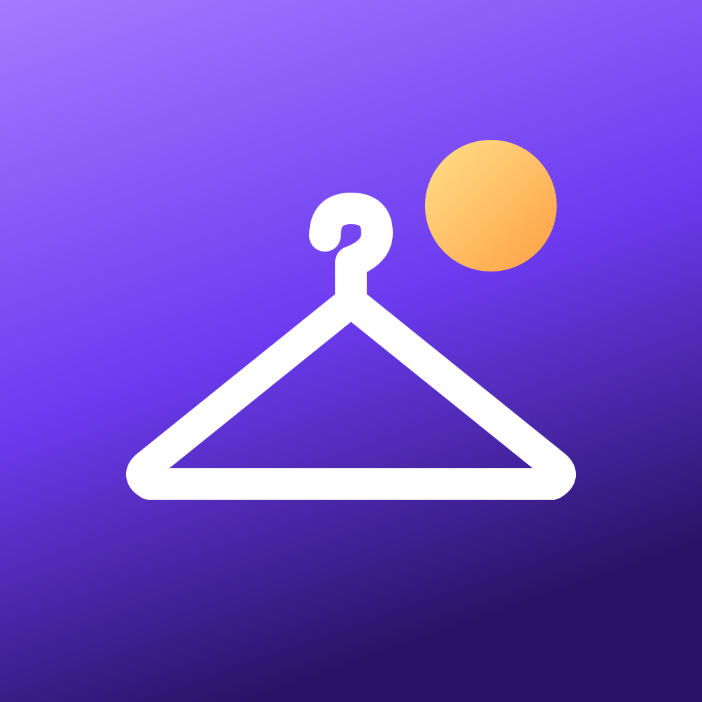

<p align="center">
  
</p>

<h1 align="center">HabilleToi</h1>

<p align="center">
  <strong>Ta tenue du jour, composée avec tes vêtements et la météo.</strong><br>
  Application mobile iOS / Android en React Native et Expo.
</p>

<p align="center">
  
  
  
  
  
</p>

---

## Sommaire

- [Fonctionnalités](#fonctionnalités)
- [Stack technique](#stack-technique)
- [Démarrage rapide](#démarrage-rapide)
- [Configuration](#configuration)
- [Structure du projet](#structure-du-projet)
- [Confidentialité](#confidentialité)

## Fonctionnalités

### ☀️ Tenue du jour
- Des tenues composées chaque jour avec **tes vêtements propres**, selon la météo d'aujourd'hui, de demain ou d'après-demain.
- **Swipe** à droite pour garder, à gauche pour passer, puis « **Je la porte** » pour l'ajouter à l'historique.
- Choix de l'**occasion** de la journée, devinée si tu le souhaites à partir de ton **calendrier**.
- Fiche « **Plus d'infos** » : pluie, vent et détails de la journée.
- **Widget** iOS de la tenue du jour et **rappel chaque matin** par notification.

### 👕 Dressing
- **Photo d'un vêtement** : l'app reconnaît son type et ses couleurs (Gemini Flash-Lite).
- **Détourage** gratuit et local sur iPhone (Vision), ou via un service en ligne.
- « **Tenue** » : ajoute d'un coup toutes les pièces repérées sur une photo de toi en pied, avec des photos façon boutique.
- « **Importer** » : récupère tes achats depuis **41 boutiques en ligne**, ou depuis ton propre site.
- Vêtements, accessoires, favoris et historique de ce que tu as porté.

### 🧳 Valise
- Indique ta destination et tes dates : l'app prépare une **valise adaptée à la météo du séjour**.
- Coche les pièces au fur et à mesure que tu les ranges.

### ✨ Styliste et compte
- **Assistant styliste** : pose une question, il répond à partir de ton dressing et de la météo.
- **Compte et sauvegarde en ligne** pour retrouver ton dressing sur tous tes appareils.
- Questionnaire d'accueil et tutoriel à la première ouverture.

## Stack technique

| Domaine | Outils |
|---|---|
| App mobile | Expo SDK 57, React Native 0.86, React 19, Expo Router (onglets natifs), TypeScript |
| Météo | [Open-Meteo](https://open-meteo.com) (prévisions, archives, recherche de villes) |
| Back-end | Supabase : authentification, stockage, Edge Functions |
| IA | Google Gemini : reconnaissance des vêtements, analyse de tenue, photos boutique, styliste |
| Natif | Module Swift `subject-lift` (détourage Vision sur iOS), widget iOS via `expo-widgets` |

## Démarrage rapide

**Prérequis :** Node.js LTS, npm, et Xcode ou Android Studio pour les builds natifs.

```bash
git clone https://github.com/sami-krm/HabilleToi.git
cd HabilleToi
npm install
cp .env.example .env
```

Renseigne `.env` (voir [Configuration](#configuration)), puis lance l'app :

```bash
npm run ios       # build de développement iOS
npm run android   # build de développement Android
npm start         # serveur Expo (Expo Go, web)
```

> Le widget, le détourage sur iPhone et certaines fonctions natives demandent un **build de développement** : ils ne sont pas disponibles dans Expo Go. L'app reste utilisable sans eux.

## Configuration

Les variables publiques de l'app se trouvent dans `.env` (modèle : [`.env.example`](.env.example)) :

| Variable | Rôle |
|---|---|
| `EXPO_PUBLIC_SUPABASE_URL` | URL du projet Supabase |
| `EXPO_PUBLIC_SUPABASE_ANON_KEY` | Clé publique `anon` de Supabase |
| `EXPO_PUBLIC_STYLIST_URL` | *(optionnel)* proxy dédié pour le styliste |
| `EXPO_PUBLIC_RECOGNITION_URL` | *(optionnel)* ton propre service de reconnaissance, utilisé en secours sans compte connecté |
| `EXPO_PUBLIC_APP_TOKEN` | *(optionnel)* jeton de ce service, à choisir toi-même |

> Ces valeurs sont **vides** dans le dépôt : remplis-les avec **tes propres** valeurs dans ton `.env` local, qui n'est jamais versionné. Laisse-les vides si tu n'en as pas besoin : l'app fonctionne sans.

Les clés privées (Gemini, détourage) restent **côté serveur**, en secrets Supabase. Le guide pas à pas pour créer le projet, appliquer la migration et déployer les Edge Functions se trouve dans [`supabase/README.md`](supabase/README.md).

## Structure du projet

```
.
├── src/
│   ├── app/               # écrans (Expo Router) : accueil, dressing, valise, tenues
│   ├── components/        # composants d'interface partagés
│   ├── features/          # import, onboarding, valise, tutoriel, notifications…
│   ├── services/          # météo, génération de tenues, IA, synchronisation
│   ├── storage/           # persistance locale
│   ├── hooks/             # hooks React (dressing, profil, historique)
│   └── widgets/           # widget iOS de la tenue du jour
├── modules/subject-lift/  # module natif Swift (détourage Vision)
├── plugins/               # config plugins Expo
├── supabase/              # Edge Functions, migration SQL et guide
└── assets/                # icônes, logo et images
```

## Confidentialité

- Le dressing, les favoris et l'historique sont stockés **sur l'appareil**. La sauvegarde en ligne est facultative, privée et limitée à ton compte.
- L'assistant styliste reçoit une **liste texte** de tes vêtements et la météo, jamais tes photos.
- Une photo n'est envoyée pour le détourage ou l'analyse qu'après ton action.

---

<p align="center">Projet personnel de <a href="https://github.com/sami-krm">sami-krm</a>.</p>
